# Category & Feature Organization Audit Report

**Date**: October 16, 2026  
**Application**: Utility Tool (Flutter Cross-Platform)  
**Scope**: Full audit across all 18 categories in `ToolCategory` (`lib/core/models/tool_model.dart`) and corresponding screen files.

---

## 1. Executive Summary

A comprehensive multi-agent audit was conducted to review feature categorization and ensure strict category boundaries across the application. 

### Recent Actions Taken
- **Zip & Compression Streamlining**:
  - [`FileZipToolkitScreen`](file:///d:/Cross%20Platform%20Applications/Utility%20Tool/lib/features/file_tools/file_zip_toolkit_screen.dart) was pruned down strictly to archive creation and extraction (`Create ZIP`, `Extract ZIP`).
  - [`ArchivePreviewToolkitScreen`](file:///d:/Cross%20Platform%20Applications/Utility%20Tool/lib/features/file_tools/archive_preview_toolkit_screen.dart) was pruned down strictly to archive formats (`TAR.GZ` and `7-Zip`).
  - Nine unrelated utilities (Batch Rename, Duplicate Finder, Size Analyzer, Hash Calculator, MIME Metadata, CSV ⇄ JSON, Folder Compare, File Diff, and Universal File Previewer) were stripped out of the compression menus.
  - Search keywords and metadata in [`ToolRegistry`](file:///d:/Cross%20Platform%20Applications/Utility%20Tool/lib/core/registry/tool_registry.dart) were synchronized.

---

## 2. Misplaced Features Audit Across Categories

```mermaid
flowchart TD
    subgraph Compression["ToolCategory.compression"]
        Zip["ZIP & 7Z Tools (KEPT)"]
        CSV["CSV ⇄ JSON"]
        Hash["Hash Checksum (MD5/SHA)"]
        Diff["File / Folder Diff"]
        Rename["Batch Rename"]
    end

    subgraph Education["ToolCategory.education"]
        Academics["Grades & Attendance (KEPT)"]
        MathTabs["Equations, Matrices, Primes, Combinatorics, GCD/LCM"]
    end

    subgraph HomeTravel["ToolCategory.homeTravel"]
        HomeTools["Fuel, Paint, Tile, Concrete, Tank (KEPT)"]
        Land["Land Area Converter"]
        Split["Trip Expense Splitter"]
        Elec["Appliance Power"]
    end

    subgraph DateTime["ToolCategory.dateTime"]
        Dates["Age, Date Diff, Stopwatches (KEPT)"]
        Notes["Notes & Checklists"]
        Subs["Subscriptions & Bills"]
    end

    subgraph Targets["Target Relocations"]
        CalcDest["ToolCategory.calculate"]
        DevDest["ToolCategory.developer"]
        SecDest["ToolCategory.security"]
        FinDest["ToolCategory.finance"]
        ConvDest["ToolCategory.convert"]
        TextDest["ToolCategory.textTools"]
        ProdDest["ToolCategory.productivity / moreTools"]
    end

    CSV --> DevDest
    Hash --> SecDest
    Diff --> TextDest
    Rename --> ProdDest
    MathTabs --> CalcDest
    Land --> ConvDest
    Split --> FinDest
    Elec --> FinDest
    Notes --> ProdDest
    Subs --> FinDest
```

---

### Detailed Category Breakdown

### A. Compression & Archives (`ToolCategory.compression`)

| Tool / Screen | Tab / Sub-feature | Nature of Feature | Why Misplaced | Recommended Target |
|---|---|---|---|---|
| **File ZIP Toolkit** | CSV ⇄ JSON | Data serialization conversion | No archiving or compression function. Pure structured data format conversion. | `ToolCategory.developer` or `ToolCategory.convert` |
| **File ZIP Toolkit** | Hash Calculator | Cryptographic checksums (MD5, SHA-1, SHA-256) | Security integrity verification, not archive bundling. | `ToolCategory.security` or `ToolCategory.developer` |
| **File ZIP Toolkit** | Batch Rename | Bulk file pattern renaming | Operating system file management. | `ToolCategory.moreTools` |
| **File ZIP Toolkit** | Duplicate Finder & Size Analyzer | Disk storage scan | Storage cleanup and disk diagnostics. | `ToolCategory.deviceTests` or `ToolCategory.moreTools` |
| **File ZIP Toolkit** | Metadata Inspector | Binary inspection / MIME sniffing | Header analysis and debugging tool. | `ToolCategory.developer` |
| **Archive Previewer** | File Diff & Folder Compare | Text / folder tree diffing | Text inspection and difference analysis. | `ToolCategory.textTools` (merge with `TextDiffCleanerScreen`) or `ToolCategory.developer` |
| **Archive Previewer** | Universal File Previewer | Hex dump / raw content viewer | Low-level file inspection. | `ToolCategory.developer` |

---

### B. Calculations & Education (`ToolCategory.calculate` & `ToolCategory.education`)

> [!IMPORTANT]
> Currently, `ToolCategory.calculate` contains only a single percentage calculator screen, while advanced mathematical calculation engines are buried inside Education.

| Tool / Screen | Tab / Sub-feature | Nature of Feature | Why Misplaced | Recommended Target |
|---|---|---|---|---|
| [`AcademicToolkitScreen`](file:///d:/Cross%20Platform%20Applications/Utility%20Tool/lib/features/education/academic_toolkit_screen.dart) | Equation Solver | Linear, Quadratic, and 2-variable System solver | Core algebraic math computation. Belongs under calculation, not academic school admin. | `ToolCategory.calculate` |
| [`AcademicToolkitScreen`](file:///d:/Cross%20Platform%20Applications/Utility%20Tool/lib/features/education/academic_toolkit_screen.dart) | Matrix 2×2 & 3×3 | Determinants, inverses, additions, multiplications | Advanced linear algebra calculation. | `ToolCategory.calculate` |
| [`AcademicToolkitScreen`](file:///d:/Cross%20Platform%20Applications/Utility%20Tool/lib/features/education/academic_toolkit_screen.dart) | GCD & LCM | Greatest common divisor & lowest common multiple | Number theory arithmetic. | `ToolCategory.calculate` |
| [`AcademicToolkitScreen`](file:///d:/Cross%20Platform%20Applications/Utility%20Tool/lib/features/education/academic_toolkit_screen.dart) | Prime Tools | Primality testing, prime factorization, Sieve of Eratosthenes | Pure math number theory. | `ToolCategory.calculate` |
| [`AcademicToolkitScreen`](file:///d:/Cross%20Platform%20Applications/Utility%20Tool/lib/features/education/academic_toolkit_screen.dart) | Permutations & Combinations | Combinatorics (nPr, nCr) | Discrete mathematics calculations. | `ToolCategory.calculate` |
| [`AcademicToolkitScreen`](file:///d:/Cross%20Platform%20Applications/Utility%20Tool/lib/features/education/academic_toolkit_screen.dart) | Scientific Calc Tab | Embedded scientific keypad calculator | Duplicates the primary scientific calculator screen. | Consolidate into `ToolCategory.calculate` |
| [`percentage_calculator_screen.dart`](file:///d:/Cross%20Platform%20Applications/Utility%20Tool/lib/features/math/percentage_calculator_screen.dart) | Percentage Screen | Standalone percentage calculator | Currently isolated as the only tool under `calculate`. | Expand `ToolCategory.calculate` into a full Math Suite with the math tabs above. |

*Features remaining strictly in `ToolCategory.education`: **Marks & Grade Calculator**, **Target Exam Score Calculator**, and **Attendance Tracker**.*

---

### C. Home & Travel vs. Finance & Converters (`ToolCategory.homeTravel`)

| Tool / Screen | Tab / Sub-feature | Nature of Feature | Why Misplaced | Recommended Target |
|---|---|---|---|---|
| [`ElectricityBillScreen`](file:///d:/Cross%20Platform%20Applications/Utility%20Tool/lib/features/finance/electricity_bill_screen.dart) | Entire Screen | Tiered power utility bill calculation | File is located in `lib/features/finance/` and uses `AppColors.catFinance`, but registered under `homeTravel`. Missing from Finance tab. | Re-register under **`ToolCategory.finance`** |
| [`HomeTravelToolkitScreen`](file:///d:/Cross%20Platform%20Applications/Utility%20Tool/lib/features/home/home_travel_toolkit_screen.dart) | Appliance Power Tab | Wattage and kWh cost calculator | Directly duplicates `ElectricityBillScreen`. | Consolidate into `ElectricityBillScreen` in `ToolCategory.finance` |
| [`HomeTravelToolkitScreen`](file:///d:/Cross%20Platform%20Applications/Utility%20Tool/lib/features/home/home_travel_toolkit_screen.dart) | Land Area Converter | Acre, Hectare, Sq Ft, Bigha, Guntha, Cent conversions | Pure area unit conversion. | Move to [`UnitConverterScreen`](file:///d:/Cross%20Platform%20Applications/Utility%20Tool/lib/features/converters/unit_converter_screen.dart) under **`ToolCategory.convert`** |
| [`HomeTravelToolkitScreen`](file:///d:/Cross%20Platform%20Applications/Utility%20Tool/lib/features/home/home_travel_toolkit_screen.dart) | Trip Expense Splitter | Multi-person debt settlement and bill splitting | Personal finance and debt tracking tool. | Move to **`ToolCategory.finance`** (alongside [`TipSplitScreen`](file:///d:/Cross%20Platform%20Applications/Utility%20Tool/lib/features/finance/tip_split_screen.dart)) |
| [`HomeTravelToolkitScreen`](file:///d:/Cross%20Platform%20Applications/Utility%20Tool/lib/features/home/home_travel_toolkit_screen.dart) | Download Time Estimator | File size vs bandwidth transfer calculation | Network data speed and transfer calculation. No connection to travel or home maintenance. | Move to `ToolCategory.developer` or `ToolCategory.convert` |

---

### D. Date & Time vs. Productivity (`ToolCategory.dateTime`)

> [!WARNING]
> `ProductivityToolkitScreen` is housed under `ToolCategory.dateTime`, but the majority of its sub-features have no relation to date calculations.

| Tool / Screen | Tab / Sub-feature | Nature of Feature | Why Misplaced | Recommended Target |
|---|---|---|---|---|
| [`ProductivityToolkitScreen`](file:///d:/Cross%20Platform%20Applications/Utility%20Tool/lib/features/productivity/productivity_toolkit_screen.dart) | Scratchpad Notes | Multi-note editor with local persistence | General office note-taking; unrelated to date/time arithmetic. | `ToolCategory.moreTools` or dedicated `productivity` category |
| [`ProductivityToolkitScreen`](file:///d:/Cross%20Platform%20Applications/Utility%20Tool/lib/features/productivity/productivity_toolkit_screen.dart) | To-Do Checklists | Task list manager with category tags | Task management; unrelated to date/time arithmetic. | `ToolCategory.moreTools` or dedicated `productivity` category |
| [`ProductivityToolkitScreen`](file:///d:/Cross%20Platform%20Applications/Utility%20Tool/lib/features/productivity/productivity_toolkit_screen.dart) | Subscription Manager | Recurring subscription cost tracker | Personal recurring financial expense tracking. | Move to **`ToolCategory.finance`** |
| [`ProductivityToolkitScreen`](file:///d:/Cross%20Platform%20Applications/Utility%20Tool/lib/features/productivity/productivity_toolkit_screen.dart) | Bill Due Dates | Due date tracker with payment status | Financial bill tracking and reminder system. | Move to **`ToolCategory.finance`** |

*Features remaining in Date & Time: **Work Hours / Time Card** and **Mini Calendar**.*

---

### E. Text Tools, OCR & Media (`ToolCategory.textTools`)

| Tool / Screen | Tab / Sub-feature | Nature of Feature | Why Misplaced | Recommended Target |
|---|---|---|---|---|
| [`OcrToolkitScreen`](file:///d:/Cross%20Platform%20Applications/Utility%20Tool/lib/features/ocr_tools/ocr_toolkit_screen.dart) | Photo OCR & OCR to PDF | Camera document capture, ML Kit OCR, PDF export | Belongs with document scanning and PDF tools rather than text analysis. | Move to **`ToolCategory.pdfDocuments`** (alongside [`DocumentScannerScreen`](file:///d:/Cross%20Platform%20Applications/Utility%20Tool/lib/features/documents/document_scanner_screen.dart)) |
| [`OcrToolkitScreen`](file:///d:/Cross%20Platform%20Applications/Utility%20Tool/lib/features/ocr_tools/ocr_toolkit_screen.dart) | Speech-to-Text & Text-to-Speech | Voice input transcription & TTS voice engine | Audio/voice processing; unrelated to text editing. | Move to **`ToolCategory.media`** ('Audio & Video') |
| [`MarkdownEditorScreen`](file:///d:/Cross%20Platform%20Applications/Utility%20Tool/lib/features/text_tools/markdown_editor_screen.dart) | Styling Theme | Uses `AppColors.catPdf` instead of `AppColors.catText` | Styling mismatch in scaffold header. | Update scaffold to use `AppColors.catText` |

---

### F. Image & Photo Tools (`ToolCategory.imagePhoto`)

| Tool / Screen | Tab / Sub-feature | Nature of Feature | Why Misplaced | Recommended Target |
|---|---|---|---|---|
| [`ImageToolkitScreen`](file:///d:/Cross%20Platform%20Applications/Utility%20Tool/lib/features/image_tools/image_toolkit_screen.dart) | Base64 Tab | Encodes image bytes to base64 Data URI strings | Web development / API data URI serialization tool. | Move to [`DevToolsScreen`](file:///d:/Cross%20Platform%20Applications/Utility%20Tool/lib/features/dev_tools/dev_tools_screen.dart) under **`ToolCategory.developer`** |
| [`ImageToolkitScreen`](file:///d:/Cross%20Platform%20Applications/Utility%20Tool/lib/features/image_tools/image_toolkit_screen.dart) | Combine Tab | Stitches multiple images side-by-side or stacked | Directly duplicates [`CollageMakerScreen`](file:///d:/Cross%20Platform%20Applications/Utility%20Tool/lib/features/image_tools/collage_maker_screen.dart). | Merge into `CollageMakerScreen` |

---

## 3. Implementation Status (Completed)

All four phases outlined in the reorganization audit have been fully executed and verified with 100% test passing across the repository (316/316 tests green):

1. **Phase 1: Consolidate Math into `ToolCategory.calculate` (COMPLETED)**
   - Created [`MathToolkitScreen`](file:///d:/Cross%20Platform%20Applications/Utility%20Tool/lib/features/math/math_toolkit_screen.dart) containing Equation Solver, Matrices, GCD & LCM, Prime Tools, Combinatorics, and Scientific Calculator.
   - Registered under `ToolCategory.calculate` in [`ToolRegistry`](file:///d:/Cross%20Platform%20Applications/Utility%20Tool/lib/core/registry/tool_registry.dart).
   - Focused [`AcademicToolkitScreen`](file:///d:/Cross%20Platform%20Applications/Utility%20Tool/lib/features/education/academic_toolkit_screen.dart) strictly on Marks, Exam Target, and Attendance.

2. **Phase 2: Fix Finance Category Mismatches (COMPLETED)**
   - Re-registered `ElectricityBillScreen` directly under **`ToolCategory.finance`** in [`ToolRegistry`](file:///d:/Cross%20Platform%20Applications/Utility%20Tool/lib/core/registry/tool_registry.dart).
   - Pruned duplicate Appliance Power tab from [`HomeTravelToolkitScreen`](file:///d:/Cross%20Platform%20Applications/Utility%20Tool/lib/features/home/home_travel_toolkit_screen.dart).
   - Integrated full Trip/Group Expense Splitter into [`TipSplitScreen`](file:///d:/Cross%20Platform%20Applications/Utility%20Tool/lib/features/finance/tip_split_screen.dart) in `ToolCategory.finance` with pairwise debt settlement algorithm.
   - Registered Subscriptions & Recurring Bills (`subscriptions_bills`) in `ToolCategory.finance`.

3. **Phase 3: Clean up Converters and Developer Tools (COMPLETED)**
   - Added Indian regional Land Area units (`Cent`, `Guntha`, `Ground`, `Bigha`, `Bigha (UP/Bihar Pucca)`, `Bigha (Bengal/Assam)`) to [`UnitConverterScreen`](file:///d:/Cross%20Platform%20Applications/Utility%20Tool/lib/features/converters/unit_converter_screen.dart) in `ToolCategory.convert`.
   - Added Download Time Estimator tab and calculation engine to [`DevToolsScreen`](file:///d:/Cross%20Platform%20Applications/Utility%20Tool/lib/features/dev_tools/dev_tools_screen.dart) in `ToolCategory.developer`.
   - Added direct launch link to `CollageMakerScreen` in [`ImageToolkitScreen`](file:///d:/Cross%20Platform%20Applications/Utility%20Tool/lib/features/image_tools/image_toolkit_screen.dart).

4. **Phase 4: Reorganize OCR, Media & Markdown (COMPLETED)**
   - Re-categorized `ocr_toolkit` under **`ToolCategory.pdfDocuments`** in [`ToolRegistry`](file:///d:/Cross%20Platform%20Applications/Utility%20Tool/lib/core/registry/tool_registry.dart) alongside `DocumentScannerScreen` and `PdfToolkitScreen`.
   - Registered dedicated Voice Studio (`voice_studio`) under **`ToolCategory.media`** with initial tab set to Text-to-Speech & Speech-to-Text.
   - Added Voice Studio direct launch banner in [`MediaToolsScreen`](file:///d:/Cross%20Platform%20Applications/Utility%20Tool/lib/features/file_tools/media_tools_screen.dart).
   - Corrected [`MarkdownEditorScreen`](file:///d:/Cross%20Platform%20Applications/Utility%20Tool/lib/features/text_tools/markdown_editor_screen.dart) accent and tab styling to `AppColors.catText`.

5. **Package Dependency Maintenance (COMPLETED)**
   - Audited all dependencies against current Dart SDK 3.11.1 constraint.
   - Upgraded compatible packages: `crypto: ^3.0.8`, `file_picker: ^13.3.0` and platform sub-packages (`android_file_picker 2.1.2`, `file_picker_darwin 2.4.0`, `file_picker_platform_interface 4.2.0`, `file_picker_web 4.2.0`, `posix 6.5.3`, `vm_service 15.4.0`).
   - Retained stable versions for packages requiring Dart SDK >= 3.12/3.13 (`google_mlkit_document_scanner`, `google_mlkit_text_recognition`, `xml`, `cupertino_icons`, `speech_to_text`, `pdf`, `printing`, `syncfusion_flutter_pdf`) to prevent build failures.
   - Hardened `image` decoders in `collage_maker_screen.dart`, `image_toolkit_screen.dart`, and `photo_editor_service.dart` against malformed/short byte inputs.

